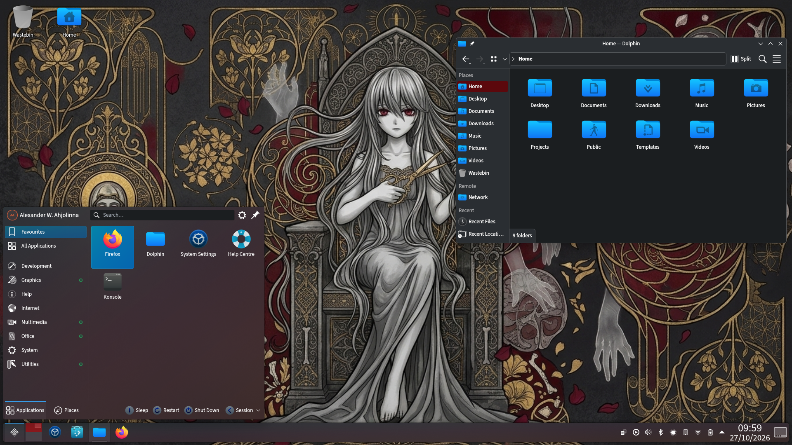

# AtropOS

**Powered by openSUSE • Sealed by AtropOS**

The fresh software of a rolling openSUSE, on the calm of a long-term kernel, sealed so an update cannot take the desktop with it. AtropOS is that combination, tuned until it feels like the machine you sit down at every day.

## Best of both worlds

Slowroll keeps the desktop current. The LTS kernel keeps the foundation steady. The system itself is immutable: the base updates as one snapshot, and your applications live in Flatpak. You get new software without living on the edge, and a system that comes back if an update goes wrong.

## Tuned for the person using it

The machine already feels finished. Sit down and the desktop is yours: dark, quiet, and quick, whether the evening is work or play.

- Tabs, music, and a game can share the machine and still feel light
- When the machine is under pressure, the session you are in comes first
- At the desk it gives you everything. On battery it settles into a calmer stride
- The keyboard and mouse stay ready while the rest of the machine rests
- A long download stays polite, so a call or a match keeps its rhythm
- Big file copies fade into the background
- Startup is a quiet path onto the desktop. After a rough stop, the boot menu is there to greet you
- The file manager opens on your home, clean and uncluttered
- A new account opens on Aether Dark, with the splash, wallpapers, and fonts already chosen
- Firefox and the daily applications arrive on the first login

## Ready when you play

Games are welcome from the first boot. Controllers are recognized, and Windows titles through Steam and Proton meet a system that was prepared for them. The lighting on your gear can be shaped from OpenRGB.

Choose NVIDIA and the open driver sets itself up. The graphics card knows when to rest, and closing the lid leaves your session waiting for you.

## Updates, from the desktop

Discover on AtropOS can see the system update and apply it as one snapshot. This is a proof of concept: one system update, applied cleanly, with the restart left to you. Flatpak applications keep updating on their own.

The version you were using stays. If the new one is not the one you want, start the previous version and the desktop is as you left it.

## A quiet checkup

Each boot, AtropOS looks the system over and sets right the settings that have drifted. Your files stay yours, and the version you are running stays the one you chose.

## A way back

Atychia is there when Plasma sticks. One chord opens a recovery screen and can return you to the session you were in.
